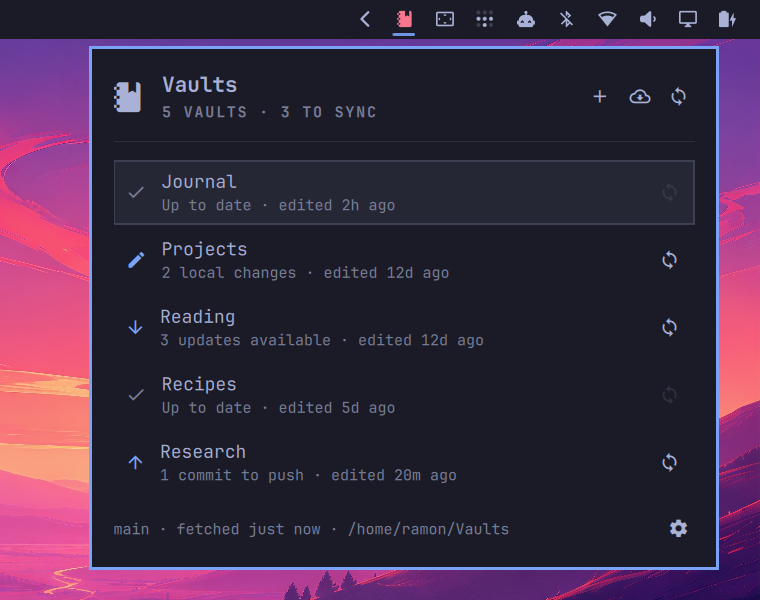
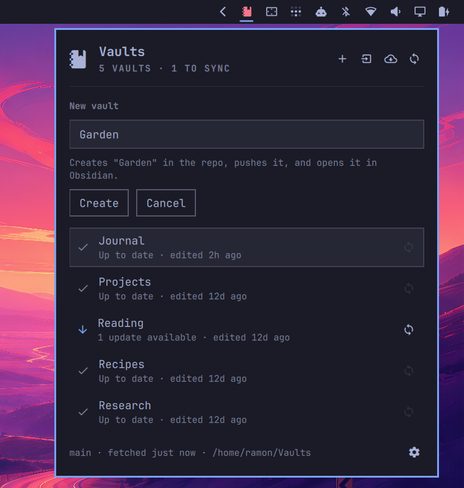
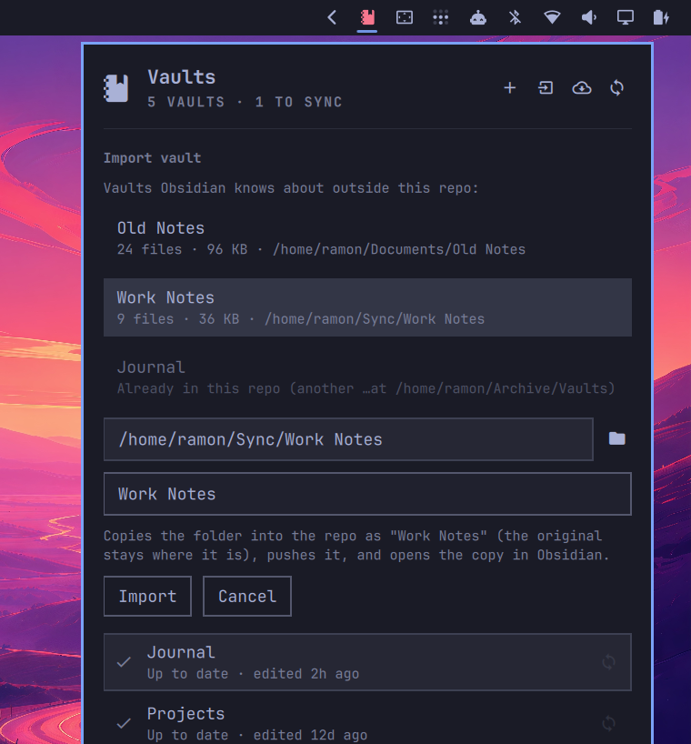
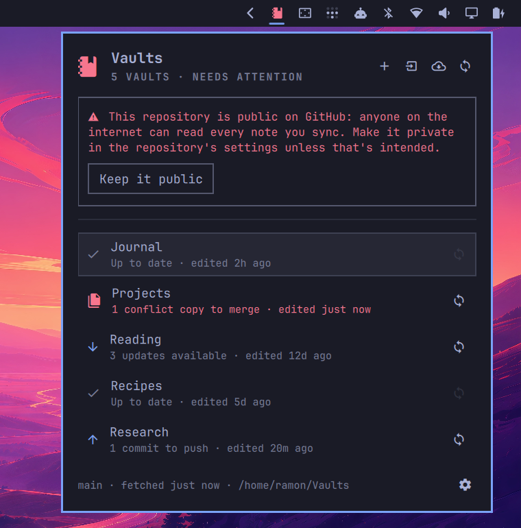
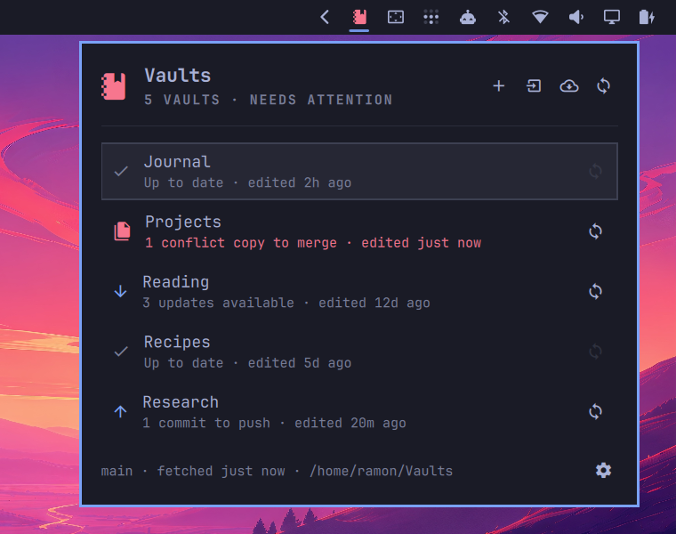
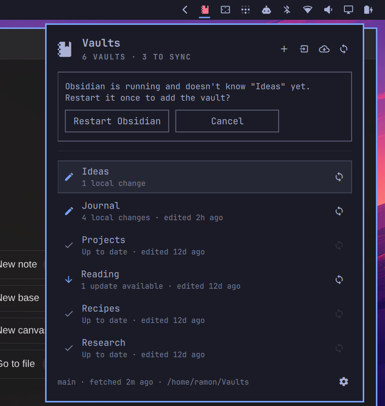

# omaVaults

An Omarchy bar widget for Obsidian vaults kept in a git repository. One repo
holds many vaults (each top-level folder is a vault); the panel shows every
vault's sync state, syncs on demand, and opens a vault in Obsidian on click.

<p align="center">
  
</p>

## Requirements

- Omarchy 4 (Quattro) with its bundled Quickshell plugin host
- `git`, `jq`, `rsync`, `curl`, `flock` and `setsid` (util-linux), `pgrep` (procps),
  `xdg-open`, and `omarchy-notification-send`; all ship with Omarchy
- [Obsidian](https://obsidian.md) installed with the `obsidian://` URI handler
- For **Browse**: the XDG desktop portal plus `python-gobject` (both ship
  with Omarchy), or `zenity`/`kdialog`. Without them, type the path instead.
- Non-interactive git access to your vaults repo (see *Authentication*)

No root privileges, packages, services, or installers are needed.

## Install

```bash
omarchy plugin add https://github.com/ramoncardena/omavaults.git --enable
```

For local development, copy the working tree into the plugins folder (the
shell rejects symlinks) and enable it:

```bash
scripts/dev-sync.sh
```

Then click the notebook icon in the bar, enter the repository URL and a local
folder (default `~/Vaults`), **Save**, and **Clone repository**.

Settings live in the widget's entry in `~/.config/omarchy/shell.json`, with a
copy in `~/.config/omavaults/config.json`. The `shell.json` entry wins when
present; the copy is used when it's missing, e.g. after disabling and
re-enabling the widget (which resets its `shell.json` entry):

```json
{ "id": "io.github.ramoncardena.omavaults",
  "repoUrl": "git@github.com:you/vaults.git",
  "localPath": "~/Vaults",
  "refreshIntervalSec": 300 }
```

### Authentication

The widget can't show a prompt, so git must authenticate on its own. SSH runs
in `BatchMode`, and HTTPS has terminal prompts disabled:

- **HTTPS**: works with any git credential helper, e.g. after
  `gh auth setup-git`.
- **SSH**: the key must be usable without typing a passphrase, either loaded
  into an agent or unencrypted. If the shell has no `SSH_AUTH_SOCK`, the
  helper falls back to systemd's `$XDG_RUNTIME_DIR/ssh-agent.socket`.

## Use

| Action | Mouse | Keyboard |
|---|---|---|
| Open vault in Obsidian | click a row | `↑`/`↓`, `Enter` |
| Sync one vault | row's sync button | `s` |
| Sync all vaults | ⟳ in the header / right-click bar icon | `S` |
| Fetch remote status | cloud button in the header | `r` |
| Create a vault | `+` button | `n`, type a name, `Enter` |
| Import an existing vault | import button | `i`, pick or type a folder, `Enter` |
| Repository settings | ⚙ button | `,` |
| Close panel | click outside | `Esc` |

The bar icon highlights when any vault is out of sync.

### New vaults

**New vault** creates a top-level folder with a minimal `.obsidian/` config,
a `Welcome.md`, and a `.gitignore` for Obsidian's per-device files
(`workspace*.json`, cache, `.trash/`), then commits, pushes, and opens it in
Obsidian. If the push fails (offline, auth), the vault is still created and
committed locally and shows as *commits to push*. Names can't start with `.`
or contain `/`.

<p align="center">
  
</p>

### Importing a vault

**Import** copies an existing vault folder into the repo as a new top-level
vault, then commits, pushes, and opens the copy in Obsidian. The original is
only read, never changed or moved; delete it yourself once you're happy with
the copy.

- The form lists the vaults Obsidian already knows about outside the repo.
  Folders that are just another clone of this same repo are shown as
  duplicates and can't be imported. Any other folder can be typed in, or
  chosen with **Browse** (the folder button, or `Ctrl+O` in the folder
  field), which opens your desktop's folder dialog through the XDG desktop
  portal. The panel hides while the dialog is open and comes back with the
  path filled in.
- The name defaults to the folder's name and must not already exist.
- `.git`, `.obsidian/workspace*.json`, `.obsidian/cache`, and `.trash/` are
  not copied; a per-vault `.gitignore` is added if the folder has none.
- Imports are refused if any file is 95 MB or larger, since git hosts reject
  files near 100 MB.
- If the folder was its own git repo, its history is not carried over.

<p align="center">
  
</p>

### Sync states

| State | Meaning |
|---|---|
| Up to date | nothing to do |
| local changes | uncommitted edits |
| commits to push | committed locally, not pushed |
| updates available | remote has new commits for this vault |
| diverged | both sides changed; sync will combine them |
| conflict copies to merge | a note was edited on two devices; see below |
| conflict | a rebase/merge you started by hand is in progress in the repo |

**Sync** = `git add` + commit (scoped to the vault, or everything for Sync
all) → `fetch` → `rebase --autostash` onto upstream → `push`. Nothing is ever
force-pushed, and published history is never rewritten.

### Public repositories

If the repository is public on GitHub, GitLab, or Codeberg, the panel shows a
warning: anyone on the internet can read every note you sync. It also appears
before you clone, so you see it while setting up. Private is strongly
recommended. If the repository is meant to be public (a digital garden, say),
click **Keep it public**; that choice is remembered per repository URL in
`~/.config/omavaults/config.json`, and the warning returns for any other public
repository. Other hosts and local paths aren't checked.

<p align="center">
  
</p>

### Notes edited on two devices

When the same note changed here and on another device, the sync still
finishes, and nothing is lost:

```
Projects/Index.md                                   ← the version from the remote
Projects/Index (conflict laptop 2026-10-16 1409).md ← your version, from this device
```

<p align="center">
  
</p>

- The copy is committed and pushed, so every device sees it. The vault shows
  *conflict copies to merge*, the bar icon flags it, and a notification names
  the files.
- Merge the two by hand, delete the copy, and sync again.
- If one device deleted a note and the other edited it, the edit is kept and no
  copy is made.
- One copy per note per sync: if several unsynced local commits touched the same
  note, the copy holds your latest version.
- Works for attachments too (the copy is byte-for-byte your file).
- No conflict markers are ever written into notes. If something can't be
  combined automatically, the sync stops cleanly instead: your changes stay
  committed locally, unpushed, and the panel says how to resolve them.

Status refreshes locally every minute and fetches from the remote every
`refreshIntervalSec`. The bar runs one widget per monitor; they share a single
fetch per interval, and finished actions refresh every screen.

### IPC

```bash
omarchy-shell io.github.ramoncardena.omavaults toggle   # also open/close/show/hide
omarchy-shell io.github.ramoncardena.omavaults syncAll  # e.g. from a Hyprland bind
omarchy-shell io.github.ramoncardena.omavaults fetch
omarchy-shell io.github.ramoncardena.omavaults refresh
```

### Obsidian integration

Obsidian only opens vaults listed in `~/.config/obsidian/obsidian.json`, and
only reads that file at startup (a running instance rewrites it from memory).
omaVaults changes that list only when you ask, and never behind
Obsidian's back:

- **Opening a vault** from the panel adds that vault to the list.
- When repo vaults are missing from the list, the panel **asks** whether to
  add them (**Add to Obsidian**, or **Restart Obsidian and add** while it's
  running). **Not now** is remembered for those vaults, so you're only asked
  again when a new one appears, and vaults you removed from Obsidian on
  purpose stay removed.
- It writes `obsidian.json` only while Obsidian is not running, adds entries in
  Obsidian's own format, and never edits or removes existing ones.
- If you open a vault Obsidian doesn't know yet while it's running, it asks to
  restart Obsidian once (`Enter` confirms), then opens the vault.

<p align="center">
  
</p>

Tip: add `.obsidian/workspace*.json` to the repo's `.gitignore`, or every
vault will look modified whenever you open it.

## Safety and privacy

Like every Omarchy plugin, omaVaults runs unsandboxed as your user. Inspect
the source before installing. What it does:

- **Network (visibility check)**: one anonymous request to the host's API
  (`api.github.com/repos/<owner>/<repo>`, or the GitLab/Codeberg equivalent)
  when the shell starts and when the repository URL changes, to warn you if
  the repository is public. It sends no credentials, follows no redirects,
  reads only the status code, and is cached for an hour in
  `~/.cache/omavaults/visibility.json`.
- **Network (git)**: only `git clone`/`fetch`/`push` to the repository you
  configure. No telemetry and no other requests.
- **Reads**: folders you choose to import (copied, never modified), and the
  vault list in `~/.config/obsidian/obsidian.json`.
- **Writes**: the configured local folder (your vaults repo) and new vault
  folders inside it; `~/.config/obsidian/obsidian.json`, where vault entries
  are added only when you open a vault or choose **Add to Obsidian**, only
  while Obsidian is not running, and existing entries are never changed;
  its own widget entry in `~/.config/omarchy/shell.json` and
  `~/.config/omavaults/config.json` when you save settings.
- **Git**: commits with your configured git identity. It never force-pushes
  or rewrites published history. Notes changed on both sides are kept as
  conflict copies next to the original.
- **Processes**: launches Obsidian through `xdg-open`. It quits Obsidian
  (`SIGTERM`, a normal shutdown) only after you confirm the restart prompt.
- No root, no services, no background daemons beyond the shell itself.

**Who you let push to the repository matters.** Each vault's `.obsidian/`
folder is synced, including community plugins, and Obsidian runs plugin code.
Anyone with write access to the vaults repository (another device, a
collaborator, a bot token) can therefore change what runs in Obsidian on all
your devices. Give write access only to devices and people you trust with
that, and prefer read-only or narrowly scoped tokens for automation.

Keep credentials out of the repository URL (`https://user:token@…`): Omarchy
stores widget settings in `~/.config/omarchy/shell.json`, which other local
users can read. Use a git credential helper instead (for example
`gh auth setup-git`); omaVaults also masks any credentials it finds in URLs
in its panel and error messages.

## Remove

```bash
omarchy plugin remove io.github.ramoncardena.omavaults --yes
```

Removing the plugin leaves your vaults folder, the `obsidian.json` entries,
and `~/.config/omavaults/` in place, so a reinstall picks up where you left
off. Remove those yourself if you no longer want them.

## Development

```
manifest.json      Omarchy plugin manifest (bar-widget)
BarWidget.qml      entry point: state, helper processes, IPC, bar icon
Panel.qml          the popup (loaded by BarWidget.qml)
Model.js           pure presentation helpers
bin/omavaults      git/Obsidian helper; every command prints JSON
tests/run.sh       end-to-end helper tests on throwaway repos
```

```bash
tests/run.sh
omarchy plugin validate .
# qs.* imports resolve from a root containing `qs` -> $OMARCHY_PATH/shell
mkdir -p /tmp/qslint && ln -sfn "${OMARCHY_PATH:-/usr/share/omarchy}/shell" /tmp/qslint/qs
qmllint -I /tmp/qslint BarWidget.qml Panel.qml
```

## Changelog

See [CHANGELOG.md](CHANGELOG.md).

## License

[MIT](LICENSE)
